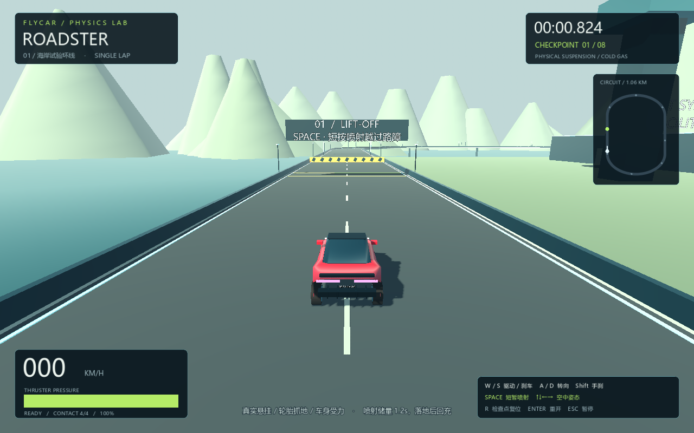
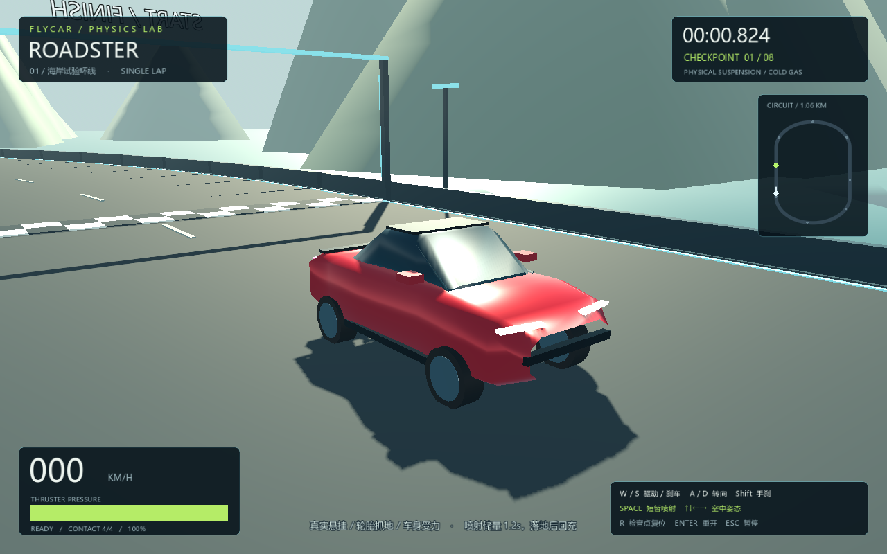

# FlyCar — Roadster Physics Lab

Godot 4.7 的单车物理竞速原型。参考第二代 Tesla Roadster 的低矮车身、玻璃座舱、细长灯组和短时喷射概念，以原创程序化简化模型呈现。





## 启动

1. 安装 **Godot 4.7.x 标准版**，导入本仓库的 `project.godot`。
2. 按 **F6/F5** 运行主场景；项目已经配置 `main.tscn` 为入口。
3. 等待三秒倒计时，沿赛道依次穿过检查点，再返回起终点。

也可运行 `godot --path .`。使用 Compatibility 渲染模式，不依赖外部模型、插件或付费资源。已在 Windows / Godot 4.7.2 / AMD Radeon 780M 上执行实际渲染检查。

## 操作

| 按键 | 功能 |
| --- | --- |
| W / S | 驱动 / 刹车；接近停止时 S 倒车 |
| A / D | 前轮转向；高速时转向角减小 |
| Shift | 后轮手刹，降低后轴抓地力 |
| Space | 按住喷射，松开停止；满罐连续推力约 1.2 秒 |
| ↑ / ↓ | 空中俯仰力矩 |
| ← / → | 空中侧倾力矩 |
| R | 返回最近已通过检查点，比赛中罚时 3 秒，不补充燃料 |
| Enter | 完全重开比赛和倒计时 |
| Esc | 暂停 / 继续，计时和车辆物理同时暂停 |

## 赛道与越障

- **约 1.06 km 海岸试验环线**：一圈计时，8 个顺序检查点；逆向通过、跳过检查点均不计数。
- **01 路障**：横跨赛道的实体障碍。起步后接近绿色标线时，按 Space 约 0.4–0.5 秒，再松开，让车辆自然落地。
- **02 断桥**：有真实碰撞缺口的 25 米桥面。保持车速，在缺口前提前短喷约 0.6–0.7 秒。
- **可选空中切弯**：南弯绿色起飞台和空中环标记了一条高风险飞跃路线；需自行控制起飞方向、速度和落点。首版自动越障测试覆盖主线路障与断桥，尚未验证这条可选线路的最佳跑法。
- 喷射结束后等待 0.8 秒，且至少三个轮胎接地，储量才会回充；空中不会回充。
- 翻车可以 R 复位，掉出赛道会自动复位。最终成绩包含所有复位罚时，完赛后成绩锁定；个人最佳成绩保存到 Godot 的 `user://flycar.cfg`。

## 物理模型

`scripts/car.gd` 使用 **RigidBody3D + 四个射线车轮**，而不是给车辆直接设置位置或腾空动画。每个车轮计算弹簧压缩、阻尼、接地点速度和轮胎纵横向力；合力受摩擦圆限制。前轮转角、高速抓地、制动力、低位重心和空气阻力参与运动。

四个底盘喷口分别施加具有力臂的力。喷射随车身朝向变化，所以歪着起飞会偏航、侧倾或翻车。空中方向键只施加有限力矩，不会自动拉平车身。悬挂力、轮胎力与喷射力按物理步施加；默认物理频率 120Hz。

可在 `scripts/car.gd` 调整 `spring_rate`、`damper`、`tire_grip` 和 `nozzle_force`。这些是游戏调校参数，并非 Tesla 实车测量数据。

## 验证

Windows PowerShell：

```powershell
./tests/run.ps1 -Godot 'C:/path/to/Godot_v4.7.2-stable_win64_console.exe'
```

独立运行示例：

```sh
godot --headless --path . --script tests/test_physics.gd
```

测试涵盖燃料边界、轮胎摩擦圆、四轮静态支撑、驱动/转向、喷射起飞与耗尽、复位动量清零、检查点顺序、真实断桥碰撞、暂停、重开，以及使用真实物理输入跨越路障和断桥。`tests/capture.gd` 可在有显示设备时保存两张实际渲染截图。

## 文件结构

- `main.tscn` / `scripts/main.gd`：赛道、环境、检查点、镜头、HUD 和比赛生命周期。
- `scripts/car.gd`：刚体悬挂、轮胎、喷射和控制输入。
- `scripts/vehicle_math.gd`：燃料与轮胎摩擦圆计算。
- `scripts/geometry.gd`：原创车身和场景网格生成。
- `scripts/race_state.gd` / `scripts/minimap.gd`：顺序计圈与小地图。
- `tests/`：可重复运行的物理与规则回归测试。

## 首版范围与参考

这是可玩的物理原型：车辆为简化程序化模型，尚无精细轮拱、内饰、音效、AI 对手、联网和车辆调校菜单。尚未导出独立 EXE；直接在 Godot 中运行。测试证明基础物理与主线路障可通过，不代表已经完成人工整圈驾驶手感调校。

外形与喷射概念参考 [Tesla Roadster 官方页面](https://www.tesla.com/roadster)、[Roadster The Ramp 视频资料](https://postcutoff.com/v/tesla-roadster-the-ramp-live-demo/)、[第二代 Roadster 多视角模型预览](https://www.turbosquid.com/3d-models/tesla-roadster-2017-rigged-3d-model-1252054)。仅参考外观与动作描述，未下载或复制相关模型及视频资产。竞速节奏参考 [QQ 飞车快速出弯教学](https://www.bilibili.com/video/BV1xP4y1s7qS/)。

本项目为非官方个人原型；Tesla / Roadster 名称属于其各自权利人。
