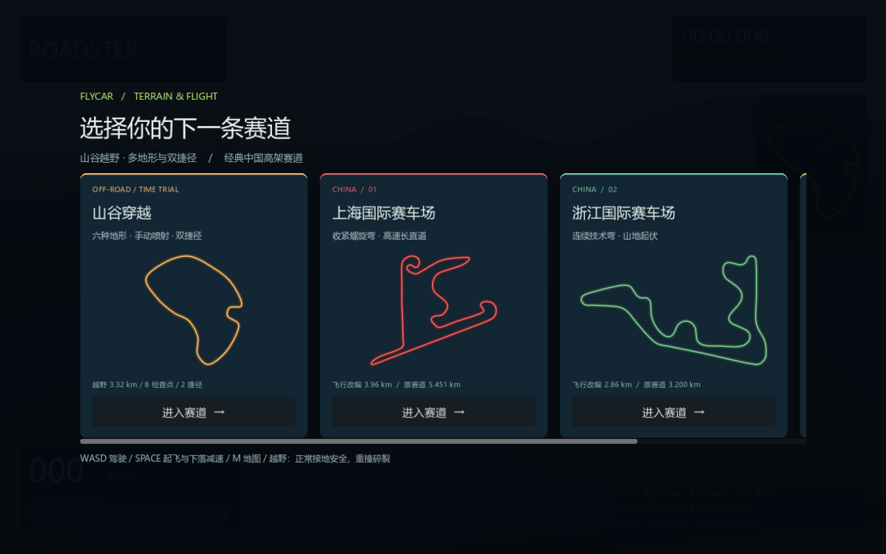
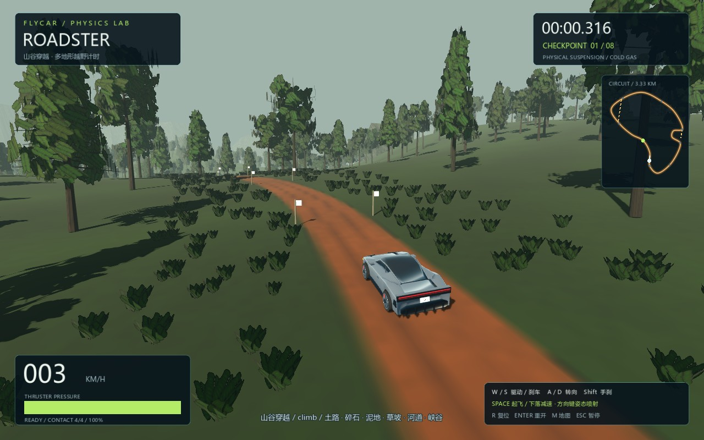
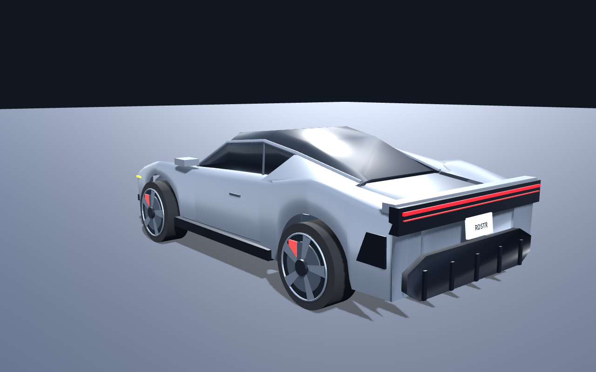
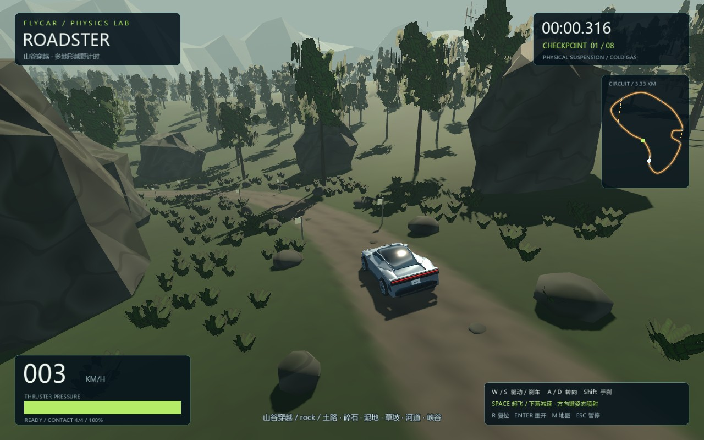
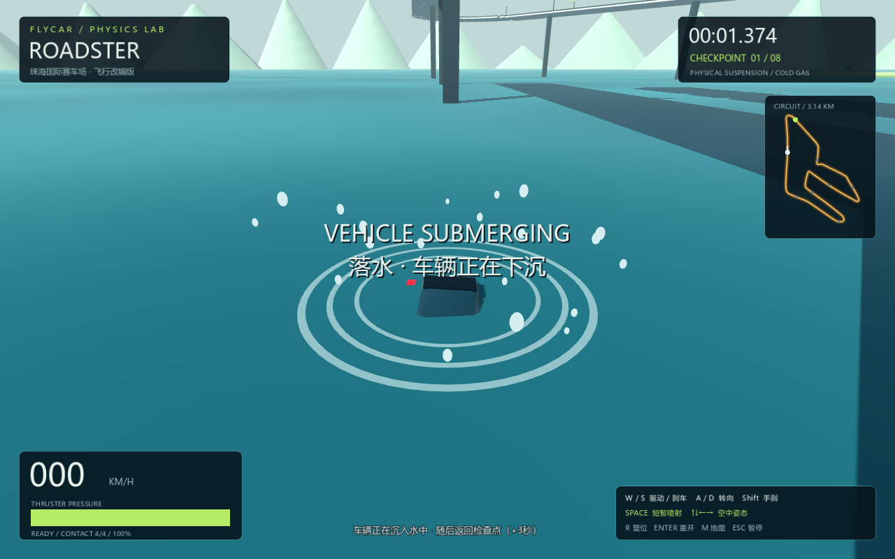
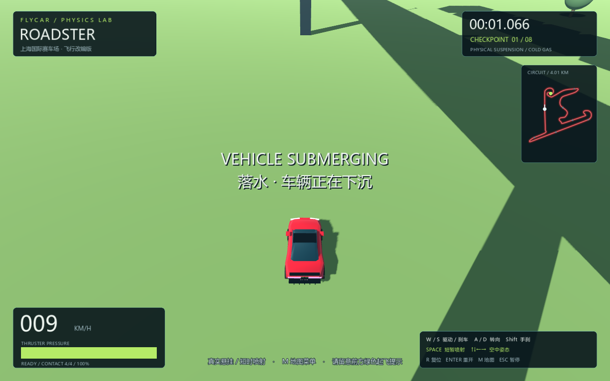
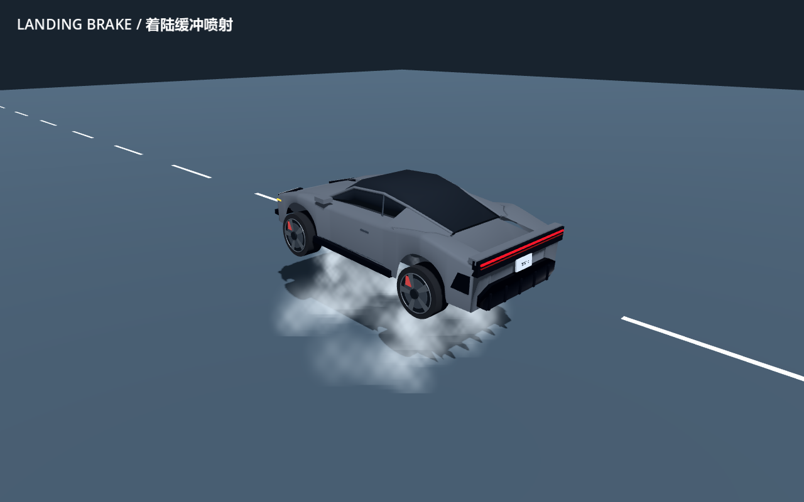
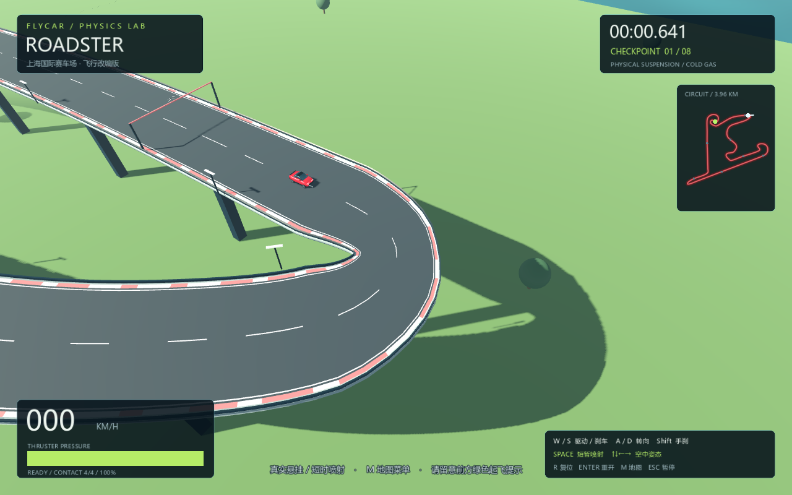

# FlyCar — 山谷越野与喷射赛车

Godot 4.7 物理赛车原型：银灰 Roadster、四轮悬挂、有限手动喷射，默认地图为 3.33 km「山谷穿越」越野计时路线。保留三张中国高架赛道，支持地图切换与独立最佳成绩。





## 银灰 Roadster 外观

参考用户提供的 Tesla Roadster 图片，重新制作低矮银灰车身、黑色溜背玻璃、独立轮拱、贯穿红色尾灯、后扩散器和五辐轮毂。模型为程序生成的原创简化版本；保留四轮物理悬挂、喷射和空中姿态控制。



## 启动与输入

1. 在 **Godot 4.7.x 标准版**导入本目录 `project.godot`，按 **F5**。
2. 在地图选择界面选择赛道，等待三秒倒计时。
3. **Godot 嵌入游戏窗口顶部必须选中“输入”，而不是“2D / 3D”调试模式。**点击游戏画面后按住 W 加速。
4. 更新代码后，先 F8 停止旧游戏，再 F5 重新运行。

也可用 `godot --path .` 独立启动，绕过编辑器的输入调试模式。没有外部模型、付费资源或插件依赖。

## 默认越野地图：山谷穿越

约 **3.33 km** 密林山谷闭环路线，8 个顺序检查点，主路由浅色路旗引导。地图菜单中越野排在第一张，原上海、浙江、珠海高架地图仍可切换。

路线已收窄为约 **4.7m 的单车林道**，两侧只有约 0.3m 的软路肩，路旗随边界内收。地形起伏直接作用于路面，沿线约有 32m 高差，包含多次连续爬坡、下坡和横坡；坡度超过 10% 的上、下坡段各累计约半公里。起点保留平缓区。

场景已升级为密林山谷：约 4300 棵分枝树木与叶片、林下植物、溪岸植被和石块、可碰撞岩壁、连续远山。原始树皮/叶纹/苔岩材质、轻微风动、路面车辙及水面细波均由程序生成，无需额外下载模型。植被按空间分批裁剪，主路与两条捷径保留通行廊道。

岩面区增加真实凸碰撞的低石板和路肩巨石。中心通道可通过，但偏离路线、急转和高速碾石会增加悬挂冲击与翻车风险。峡谷捷径的助跑和落点保留通行空间。



| 路面 | 驾驶反馈 |
| --- | --- |
| 夯实土路 | 抓地好，适合加速和回充气量 |
| 碎石 | 抓地下降，提前减速转弯 |
| 泥地 | 打滑且滚动阻力更大 |
| 草坡 | 可切弯，但横坡容易侧翻 |
| 浅水 | 车轮在真实河床上行驶，阻力增加并产生水花 |
| 岩石峡谷 | 起伏岩面与陡壁，主路线可安全绕行 |

黄色旗帜标记两条可选捷径，小地图使用黄色虚线：草坡切弯与峡谷飞跃。两者都在相邻检查点之间接回主路线，不能跳过检查点。峡谷沟宽约 32m，可约 70km/h 或更高接近，提前手动喷射约 0.85s，再预留下落补喷气量；这是首轮物理验证的操作参考，实际时机取决于速度和姿态。

越野正常接地、小跳和浅水涉渡不会直接损毁。严重碰撞按双方接触点的法向相对速度判断（当前阈值 12m/s，含车身翻滚速度）；深水区会沉没，侧翻可按 R 返回检查点并罚时。四个轮胎分别读取所在表面的抓地与阻力，混合路面会产生不同受力。高度查询、可见地形及碰撞共享同一组网格三角形。

## 经典中国高架地图

| 地图 | 游戏改编长度 | 参考原赛道长度 | 主要节奏 |
| --- | --- | --- | --- |
| 上海国际赛车场 | 约 3.96 km | 5.451 km | 收紧弯、长直道 |
| 浙江国际赛车场 | 约 2.86 km | 3.200 km | 连续技术弯、起伏 |
| 珠海国际赛车场 | 约 3.12 km | 4.300 km | 长直道连接急弯 |

中心线参考真实赛道图进行原创简化重建，适度压缩并旋转起跑方向。高架道路、路障、断桥及其场景均为游戏改编，**不是一比一测绘或实车训练模型**。每条路线有 8 个顺序检查点、实体越障路障及约 25 米真实断桥。地图菜单和小地图展示实际游戏中心线。

参考：[51GT3 中国赛道](https://51gt3.com/track/location/asia/china)、[上海](https://51gt3.com/track/shanghai-international-circuit)、[浙江](https://51gt3.com/track/zhejiang-international-circuit)、[珠海](https://51gt3.com/track/zhuhai-international-circuit)。轮廓视觉参考补充：[上海布局](https://www.sportscarworldwide.com/Tracks-Shanghai.html)、[浙江布局](https://app.myracingcareer.com/en/track/zhe/)、[珠海布局](https://sportscarworldwide.com/Tracks-Zhuhai.html)。参考图片仅用于观察，未打包进游戏。

## 操作

| 按键 | 功能 |
| --- | --- |
| W / S | 驱动 / 刹车，接近停止后 S 倒车 |
| A / D | 转向，高速时自动减小最大转角 |
| Shift | 后轮手刹 |
| Space | 起飞喷射 / 下落喷气减速，松开停止；满罐连续约 1.2 秒 |
| ↑↓ / ←→ | 空中俯仰 / 侧倾喷射，会消耗气量 |
| M | 打开地图选择，比赛暂停；选择后重新起跑 |
| Esc | 暂停/继续；地图菜单内返回原比赛 |
| R | 检查点复位，比赛中罚时 3 秒，不补充喷射储量 |
| Enter | 重开当前地图 |

地图菜单从暂停状态打开时，取消后仍保持暂停。切图重置计时、检查点、车速及喷射储量。各地图独立保存最佳成绩到 `user://flycar.cfg`。

## 喷射越障与环境落点

绿色标线和告示提醒提前起飞。路障可在接近时短喷约 0.4–0.5 秒。**断桥需保持约 80 km/h 或更高的接近速度**，提前短喷约 0.7 秒；低速过早起飞可能够不到对岸。停止喷射 0.35 秒后，至少两个轮胎实际承重且车身朝上即可回充；空罐有效接地约 2 秒可充满。空中、侧翻、竖墙擦碰不回充。起飞、姿态修正和落地缓冲共用同一罐气体，请预留着陆气量。

在经典高架地图中，车辆离开赛道后继续真实下落，空中不触发损毁。落到可见水面时出现水花、涟漪和落水声，整车逐渐沉入水下，约 **2.4 秒**后重生；撞到可见陆地时，车轮、车门、引擎盖和车身碎片散落，约 **1.6 秒**后重生，不出现火球。陆地接触根据碰撞盒随姿态变化的最低点判断，支持侧翻或车头先着地。计时继续，检查点重生追加 **3 秒**罚时，不补充喷射储量；没有检查点时回起点。

暂停会暂停下沉、碎片和重生倒计时。Enter 重开或切图会清理旧落水/撞击状态，不留下延迟回调。完赛后成绩锁定。上海以陆地和局部水域为主，浙江为陆地，珠海为海岸与陆地区域；这些为游戏环境设定。





## 重复喷射与回充

可以反复起飞。气量用完后会进入空罐保护；即使仍按着 Space，也会在有效接地后回充，但不会自动断续喷射。看到 RELEASE SPACE 时，松开 Space 再按即可重新喷射；RECHARGING 表示正在回充。正常短喷、小跳落地后约 2–3 秒能恢复气量，颠簸、离地或侧翻时可能更久。R 复位不直接补气。

## 喷射与落地缓冲

Space 控制起飞短喷；下落时需要再次按住 Space 向下喷气减速，方向键通过四个喷口的推力差修正俯仰和侧倾。默认关闭自动落地喷射，松开 Space 后继续自由下落；空罐后没有推力或免费姿态力矩。下降喷射移除起飞的前向推力偏置，轮胎接地后由悬挂承接。HUD 显示 LIFT、ATTITUDE 或 DESCENT BRAKE。

手动喷气只能降低下落速度，需要判断喷射时机：气量不足、下降过快、姿态不正或错过道路边界仍会硬着陆或翻车。赛道外沿用沉没/碎裂规则。白色半透明喷流沿实际推力反方向排出，接触路面后形成扩散气雾；松开喷射后自然消散。喷气音随实际推力变化，暂停、损毁、切图和重置会停止喷射。



## 后续添加地图

见 [地图数据格式](docs/adding-tracks.md)。把有效 JSON 放入 `tracks/`，菜单会自动发现。无需复制比赛控制器；超过三张地图时卡片区域可以横向滚动。

## 物理与代码

- `scripts/roadster_visual.gd`：银灰车身网格、轮拱、灯组与独立旋转的轮毂；损毁碎片沿用车漆。
- `scripts/thruster_control.gd` / `scripts/jet_effect.gd`：有限气量的四喷口分配、手动下落减速、白雾粒子及喷气声。
- `scripts/car.gd`：RigidBody3D + 四轮射线弹簧/阻尼、接地点速度、摩擦圆、手刹和空气阻力；四个喷口分别施力，起飞、空中和着陆均消耗实际喷口气量。
- `scripts/track_catalog.gd` / `tracks/*.json`：地图发现、验证、向心插值、等弧长采样与中心线平滑。
- `scripts/course.gd` / `scripts/road_ribbon.gd`：共享截面的连续道路、路肩、路缘和护栏网格及碰撞；保留真实断桥。
- `scripts/main.gd`：地图、比赛、暂停、成绩与环境落点/重生生命周期。
- `scripts/track_menu.gd` / `scripts/minimap.gd`：地图选择和自动缩放的路线预览。
- `scripts/forest_assets.gd` / `scripts/forest_scene.gd`：原创分枝树木、叶片/树皮/苔岩材质、分块森林与林下植被、实体岩壁和溪岸远山。
- `scripts/offroad_model.gd` / `scripts/offroad_terrain.gd` / `scripts/offroad_course.gd`：连续山谷地形、六类路面、检查点和双捷径；`surface_effect.gd` 负责轮胎扬尘/涉水喷花。
- `scripts/terrain.gd`：海陆可见几何、地面碰撞与落点查询共用同一组区域数据。
- `scripts/impact_effect.gd`：落水涟漪、水花、车体碎片和对应音效。

默认 120Hz Jolt 物理，Compatibility 渲染，默认 **4× MSAA** 抗锯齿，适度加宽远处白线并降低金属镜面闪烁；不启用该渲染模式不支持的 FXAA/TAA。悬挂与推力是游戏调校参数，并非 Tesla 实车测量数据。

## 验证

```powershell
./tests/run.ps1 -Godot 'C:/path/to/Godot_v4.7.2-stable_win64_console.exe'
```

当前 226 项检查通过，包括主路线真实物理驾驶整圈、两条捷径、地形/碰撞一致性、越野落地与深浅水、异常越野数据拒绝。测试还包含原物理与旧测试赛道回归、三张新地图数据/生成/接地、真实路障和断桥通过、地图/暂停切换、燃料保持、环境落点单次重生、重开与切图取消旧状态、独立记录，以及异常地图数据拒绝。旧椭圆赛道仅保存在 `tests/fixtures/` 作回归夹具，不出现在地图菜单。

`tests/capture_offroad.gd` 保存越野菜单、六类地形与概览截图。`tests/capture.gd` 可以保存菜单、三张地图、落水/碎裂和抗锯齿开关的实际渲染截图。当前没有独立 EXE、联网、AI 对手或精细赛道建筑；尚需进一步进行完整人工圈速和驾驶手感调校。

车辆外形参考 [Tesla Roadster](https://www.tesla.com/roadster)，为原创简化模型。本项目为非官方个人游戏原型。

## 弯道边界修复

路面不再用各自旋转的长方体拼接。相邻路段共享截面顶点，路面、路肩、白线、路缘和护栏沿同一条边界连续生成，碰撞也使用同一组网格顶点。急弯的内侧边界限制在曲率半径之内，极紧发夹弯逐渐收窄（正常路面18米，最窄约6米），避免边界翻折。中心线采用向心 Catmull-Rom 和等弧长重采样，去除不均匀控制点造成的小回折。赛道首尾闭合；断桥仍是有意保留的真实缺口。



### 鼠标观察环境

越野地图已移除路旗、悬空提示牌和检查点门架，通过小地图与 HUD 寻路，计时检查点保持有效。按住鼠标右键拖动环视，松开后保留角度；滚轮缩放，中键恢复车后视角。打开地图、暂停或窗口失去焦点会释放鼠标，复位与重开会重置观察角度。
