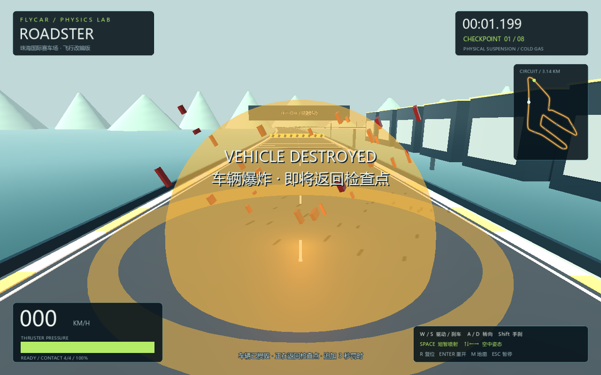

# FlyCar — 中国高架飞行赛道

Godot 4.7 物理赛车原型：Roadster 风格原创简化车型、四轮悬挂、有限喷射、三张中国赛道飞行改编版、地图切换，以及掉落爆炸与检查点重生。


## 启动与输入

1. 在 **Godot 4.7.x 标准版**导入本目录 `project.godot`，按 **F5**。
2. 在地图选择界面选择赛道，等待三秒倒计时。
3. **Godot 嵌入游戏窗口顶部必须选中“输入”，而不是“2D / 3D”调试模式。**点击游戏画面后按住 W 加速。
4. 更新代码后，先 F8 停止旧游戏，再 F5 重新运行。

也可用 `godot --path .` 独立启动，绕过编辑器的输入调试模式。没有外部模型、付费资源或插件依赖。

## 首批地图

| 地图 | 游戏改编长度 | 参考原赛道长度 | 主要节奏 |
| --- | --- | --- | --- |
| 上海国际赛车场 | 约 4.01 km | 5.451 km | 收紧弯、长直道 |
| 浙江国际赛车场 | 约 2.88 km | 3.200 km | 连续技术弯、起伏 |
| 珠海国际赛车场 | 约 3.14 km | 4.300 km | 长直道连接急弯 |

中心线参考真实赛道图进行原创简化重建，适度压缩并旋转起跑方向。高架道路、路障、断桥及其场景均为游戏改编，**不是一比一测绘或实车训练模型**。每条路线有 8 个顺序检查点、实体越障路障及约 25 米真实断桥。地图菜单和小地图展示实际游戏中心线。

参考：[51GT3 中国赛道](https://51gt3.com/track/location/asia/china)、[上海](https://51gt3.com/track/shanghai-international-circuit)、[浙江](https://51gt3.com/track/zhejiang-international-circuit)、[珠海](https://51gt3.com/track/zhuhai-international-circuit)。轮廓视觉参考补充：[上海布局](https://www.sportscarworldwide.com/Tracks-Shanghai.html)、[浙江布局](https://app.myracingcareer.com/en/track/zhe/)、[珠海布局](https://sportscarworldwide.com/Tracks-Zhuhai.html)。参考图片仅用于观察，未打包进游戏。

## 操作

| 按键 | 功能 |
| --- | --- |
| W / S | 驱动 / 刹车，接近停止后 S 倒车 |
| A / D | 转向，高速时自动减小最大转角 |
| Shift | 后轮手刹 |
| Space | 按住喷射，松开停止；满罐连续约 1.2 秒 |
| ↑↓ / ←→ | 空中俯仰 / 侧倾力矩 |
| M | 打开地图选择，比赛暂停；选择后重新起跑 |
| Esc | 暂停/继续；地图菜单内返回原比赛 |
| R | 检查点复位，比赛中罚时 3 秒，不补充喷射储量 |
| Enter | 重开当前地图 |

地图菜单从暂停状态打开时，取消后仍保持暂停。切图重置计时、检查点、车速及喷射储量。各地图独立保存最佳成绩到 `user://flycar.cfg`。

## 喷射越障与爆炸

绿色标线和告示提醒提前起飞。路障可在接近时短喷约 0.4–0.5 秒。**断桥需保持约 80 km/h 或更高的接近速度**，提前短喷约 0.7 秒；低速过早起飞可能够不到对岸。落地且喷射结束 0.8 秒后，至少三个轮胎接地才会回充；空中不回充。

车辆降到附近赛道路面下方 **8 米**时，触发一次火球、冲击环、碎片和程序合成爆炸音效。约 **1.6 秒**后返回最近合法检查点；计时继续，并追加 **3 秒**复位罚时。没有通过检查点时回起点。爆炸期间不能驾驶或用 R 重复计罚，正常在路面上方腾空不会爆炸。

暂停会暂停爆炸和重生倒计时。Enter 重开或切图会清理旧爆炸，不留下延迟重生回调。完赛后仍可复位，但成绩不会改变。



## 后续添加地图

见 [地图数据格式](docs/adding-tracks.md)。把有效 JSON 放入 `tracks/`，菜单会自动发现。无需复制比赛控制器；超过三张地图时卡片区域可以横向滚动。

## 物理与代码

- `scripts/car.gd`：RigidBody3D + 四轮射线弹簧/阻尼、接地点速度、摩擦圆、手刹和空气阻力；四个喷口分别施力，空中仅提供有限控制力矩。
- `scripts/track_catalog.gd` / `tracks/*.json`：地图发现、验证、闭合中心线采样。
- `scripts/course.gd`：批量绘制高架路面，生成实体碰撞、路障、断桥、检查点和起跑位。
- `scripts/main.gd`：地图、比赛、暂停、成绩与爆炸重生生命周期。
- `scripts/track_menu.gd` / `scripts/minimap.gd`：地图选择和自动缩放的路线预览。
- `scripts/explosion.gd`：程序化视觉与音效，无外部爆炸素材。

默认 120Hz Jolt 物理，Compatibility 渲染。悬挂与推力是游戏调校参数，并非 Tesla 实车测量数据。

## 验证

```powershell
./tests/run.ps1 -Godot 'C:/path/to/Godot_v4.7.2-stable_win64_console.exe'
```

测试包含原物理与旧测试赛道回归、三张新地图数据/生成/接地、真实路障和断桥通过、地图/暂停切换、燃料保持、爆炸单次重生、重开与切图取消旧爆炸、独立记录，以及异常地图数据拒绝。旧椭圆赛道仅保存在 `tests/fixtures/` 作回归夹具，不出现在地图菜单。

`tests/capture.gd` 可以保存菜单、三张地图及爆炸实际渲染截图。当前没有独立 EXE、联网、AI 对手或精细赛道建筑；尚需进一步进行完整人工圈速和驾驶手感调校。

车辆外形参考 [Tesla Roadster](https://www.tesla.com/roadster)，为原创简化模型。本项目为非官方个人游戏原型。
